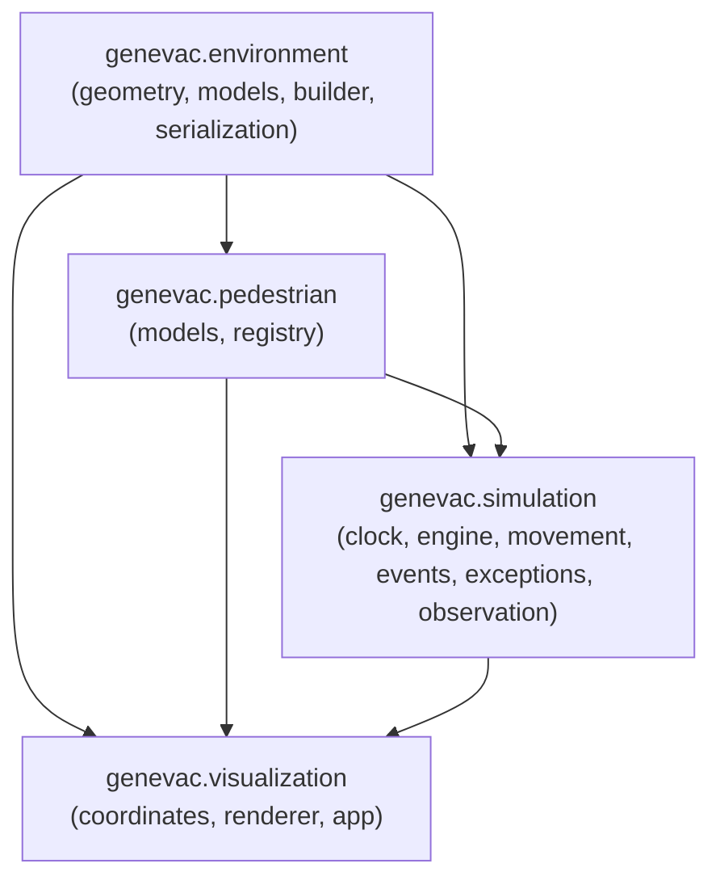

# GenEvac-Sentinel — System Architecture & Module Reference

## 1. Module Hierarchy & Dependencies

The GenEvac-Sentinel codebase is organized into four distinct modules under `src/genevac/`:

```
genevac/
├── environment/         # Spatial primitives, building components, and serialization
├── pedestrian/          # Pedestrian states, kinematics, and population registry
├── simulation/          # Authoritative simulation engine, clock, movement, and observations
└── visualization/       # Pygame rendering, viewport projection, and UI loop
```

### Module Dependency Graph



---

## 2. Detailed Module Breakdown

### 2.1 `genevac.environment`

- **Responsibility**: Defines static building components, 2D continuous geometry, floor plan validation, canonical builder, and JSON serialization.
- **Key Classes**:
  - `Point`: 2D point $(x, y)$ in continuous Euclidean space (metres).
  - `Rectangle`: Axis-aligned bounding box defined by $(x, y, \text{width}, \text{height})$.
  - `LineSegment`: 2D segment between start and end `Point`.
  - `Wall`: Physical wall with thickness, type (`EXTERIOR`, `INTERIOR`), and alignment (`CENTER`, `POSITIVE`, `NEGATIVE`).
  - `Doorway`: 2D portal connecting two adjacent walkable areas.
  - `Exit`: Exterior boundary exit portal with status (`is_open`), boundary orientation (`left`, `right`, `bottom`, `top`), and width.
  - `Obstacle`: Static interior rectangular furniture or structural pillar.
  - `WalkableArea`: Walkable room or corridor polygon bounds with topological connections.
  - `Building`: Container model aggregating all building geometry, enforcing strict spatial invariants (no overlaps, graph connectivity, portal coverage).
- **Key Functions**:
  - `create_initial_building() -> Building`: Constructs the canonical approved 40m $\times$ 30m building layout.
  - `save_building(building: Building, filepath: str | Path) -> None`: Serializes a building to a JSON file (`schema_version: "1.0"`).
  - `load_building(filepath: str | Path) -> Building`: Loads and validates a building model from JSON.
- **Dependencies**: Python standard library (`dataclasses`, `enum`, `math`, `json`, `pathlib`, `typing`).
- **Isolation Guarantee**: Zero external dependencies (no Pygame, NumPy, or Torch).

---

### 2.2 `genevac.pedestrian`

- **Responsibility**: Authoritative pedestrian state representation, physical parameters, kinematics primitives, and population registry.
- **Key Classes**:
  - `PedestrianStatus`: Enum defining lifecycle states (`ACTIVE`, `EVACUATED`, `BLOCKED`, `INACTIVE`).
  - `Velocity2D`: Immutable 2D velocity vector $(v_x, v_y)$ in m/s with scalar `speed` property and non-finite number validation.
  - `TimestampedTrajectoryPoint`: Immutable historical sample $(step, timestamp, x, y)$ with simulation clock timestamps.
  - `PedestrianState`: Authoritative agent state containing ID, position `Point`, `Velocity2D`, `PedestrianStatus`, physical radius ($r$), preferred speed ($v_{\text{pref}}$), assigned target exit ID, current area ID, waypoint list, trajectory history list, and bounded FIFO capacity (`max_history_len`).
  - `PedestrianRegistry`: Thread-safe container managing active and evacuated pedestrians with status count properties (`active_count`, `evacuated_count`, `blocked_count`, `inactive_count`, `total_count`).
- **Dependencies**: Standard library, `genevac.environment.geometry`.
- **Isolation Guarantee**: Zero external dependencies.

---

### 2.3 `genevac.simulation`

- **Responsibility**: Authoritative simulation lifecycle, deterministic progression, pathfinding, continuous collision checking, event recording, and read-only observation snapshots.
- **Key Classes**:
  - `SimulationClock`: Authoritative integer step clock that derives simulation time ($t = \text{step} \times \Delta t$) without floating-point drift, validating integer observation stride.
  - `SimulationEngine`: Manages building environment, pedestrian registry, exit opening/closing, step advancement, event logging, and snapshot creation.
  - `SimulationEvent`: Immutable event record with deterministic timestamp, step index, event type (`NO_ROUTE`, `EXIT_CLOSED`, `BLOCKED`), affected pedestrian ID, and recursively frozen metadata mapping.
  - `SimulationEventType`: Enum defining standard simulation event types.
  - `NoRouteError`: Domain exception (inheriting from `ValueError`) raised when an exit is topologically unreachable.
  - `SimulationObservationSnapshot`: Read-only, frozen dataclass emitted on observation ticks for external prediction consumers.
  - `PedestrianObservation`: Read-only, frozen dataclass providing a pedestrian observation snapshot.
- **Key Functions in `movement.py`**:
  - `generate_deterministic_route(building, start_pos, start_area_id, target_exit_id, radius)`: Computes collision-free waypoints using visibility graph + A* pathfinding.
  - `check_collision(start, end, radius, building, target_exit)`: Continuous analytical circle-swept collision check against all walls, obstacles, and non-portal boundaries.
  - `check_pedestrian_collision(start_a, end_a, radius_a, start_b, end_b, radius_b)`: Continuous dynamic collision check throughout interval $[0, 1]$ preventing tunneling.
  - `check_pedestrian_overlap(pos_a, radius_a, pos_b, radius_b)`: Evaluates physical static contact/overlap ($d < r_a + r_b$).
  - `is_position_in_walkable_space(point, radius, building, target_exit)`: Verifies that an agent's center and radius clear all static geometry.
  - `advance_population_step(pedestrians, building, dt)`: Advances a population with deterministic ID sorting, multi-pass conflict resolution, right-hand rule deflections, and safe halting.
  - `create_observation_snapshot(registry, step_count, timestamp, dt, observation_interval)`: Builds an immutable snapshot from current registry state.
- **Dependencies**: Standard library, `genevac.environment`, `genevac.pedestrian`.
- **Isolation Guarantee**: Zero external dependencies.

---

### 2.4 `genevac.visualization`

- **Responsibility**: Interactive Pygame display, aspect-ratio preserving viewport projection, simulation rendering, and user controls.
- **Key Classes**:
  - `Viewport`: Maps continuous world coordinates (metres) to screen pixels with aspect-ratio preservation, uniform margins, and center alignment.
  - `EnvironmentRenderer`: Pygame renderer drawing floors, walls, doorways, obstacles, exits, pedestrian discs, and HUD overlay. Strictly read-only; never mutates simulation state.
  - `SimulationApp`: Main application loop integrating `SimulationEngine` and `EnvironmentRenderer` with decoupled fixed-timestep accumulator, catch-up ceiling (5 steps/frame), pause/resume, and reset.
- **Key Functions**:
  - `run_app(building, json_path, population_factory, width, height, dt, max_frames)`: Entry point launching the visualizer.
- **Dependencies**: Standard library, `pygame>=2.6.0`, `genevac.environment`, `genevac.pedestrian`, `genevac.simulation`.

---

## 3. Data Flow & Contract Decoupling

The simulation state flows strictly downward from authoritative engine state to read-only views:

```
[SimulationEngine] ──── owns ────> [PedestrianRegistry] (Authoritative State)
       │                                     │
       │ generates (every 0.4s)              │ rendered by
       ▼                                     ▼
[SimulationObservationSnapshot]     [EnvironmentRenderer]
       │ (frozen, read-only)                 │ (read-only)
       ▼                                     ▼
[Person B: Prediction]               [Pygame Display Window]
```

1. **No Circular Mutation**: `EnvironmentRenderer` and Person B's prediction modules receive read-only data.
2. **Deep Immutability**: All collections in `SimulationObservationSnapshot` are immutable tuples. Mutation attempts raise `FrozenInstanceError`.
3. **Decoupled Clocks**: Visualization wall-clock accumulation does not alter the deterministic integer step count of `SimulationClock`.

