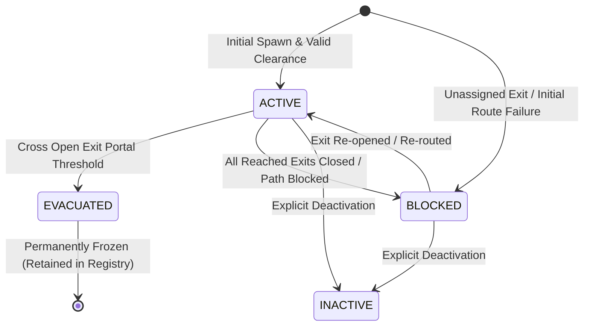

# GenEvac-Sentinel: Pedestrian Model Specification

## 1. Overview and Core Purpose

In GenEvac-Sentinel, pedestrians are modelled as discrete circular entities navigating a 2D continuous building environment. All pedestrian state representations, kinematics, historical trajectories, and population metrics are defined within `src/genevac/pedestrian/models.py` and managed centrally via `src/genevac/pedestrian/registry.py`.

The pedestrian model acts as the authoritative truth for simulated evacuees. It does **not** manage its own simulation clock; step indices and timestamps are strictly injected by the external `SimulationClock` or `SimulationEngine`.

---

## 2. Domain Data Primitives

### 2.1 PedestrianStatus Enum

Pedestrians progress through a deterministic lifecycle captured by the string enumeration `PedestrianStatus`:

```python
class PedestrianStatus(str, Enum):
    ACTIVE = "active"
    EVACUATED = "evacuated"
    BLOCKED = "blocked"
    INACTIVE = "inactive"
```

| Status | Semantics | Motion Permitted | Persistence |
| :--- | :--- | :--- | :--- |
| `ACTIVE` | Agent is actively pathfinding and navigating toward their assigned exit. | Yes ($v \ge 0$) | Registry |
| `EVACUATED` | Agent has reached an open designated exit portal and exited the building. | No ($v = 0$, frozen) | Retained indefinitely in registry |
| `BLOCKED` | Agent cannot reach an open exit (e.g., path blocked or unassigned target exit). | No ($v = 0$, zeroed) | Registry |
| `INACTIVE` | Agent is disabled, unspawned, or held in reserve. | No ($v = 0$) | Registry |

### 2.2 Velocity2D

`Velocity2D` is an immutable (`@dataclass(frozen=True)`) 2D vector expressing velocity in metres per second ($\text{m/s}$):

- **Fields**:
  - `vx: float` — Velocity along X-axis ($\text{m/s}$). Positive is rightward.
  - `vy: float` — Velocity along Y-axis ($\text{m/s}$). Positive is downward.
- **Invariants**:
  - Finite floating point values (rejects `NaN`, `+inf`, `-inf`).
  - Coerces int and float values safely.
- **Computed Properties**:
  - `speed -> float`: Euclidean magnitude $\sqrt{v_x^2 + v_y^2}$ ($\text{m/s}$).
  - `as_tuple() -> tuple[float, float]`: Export as `(vx, vy)`.

### 2.3 TimestampedTrajectoryPoint

`TimestampedTrajectoryPoint` represents an immutable point sample along the agent's path:

- **Fields**:
  - `step: int` — Integer simulation step index ($\ge 0$).
  - `timestamp: float` — Simulation elapsed time in seconds ($\ge 0.0$).
  - `x: float` — Physical X coordinate in metres.
  - `y: float` — Physical Y coordinate in metres.
- **Immutability & Safety**:
  - `@dataclass(frozen=True)`
  - Strict type and bounds checks during `__post_init__`.

---

## 3. PedestrianState Invariants and Lifecycle

`PedestrianState` encapsulates the complete dynamic and physical state of an individual evacuee:

```python
@dataclass
class PedestrianState:
    id: str
    position: Point
    velocity: Velocity2D = field(default_factory=lambda: Velocity2D(0.0, 0.0))
    status: PedestrianStatus = PedestrianStatus.ACTIVE
    target_exit_id: Optional[str] = None
    current_area_id: Optional[str] = None
    waypoints: list[Point] = field(default_factory=list)
    radius: float = 0.25  # metres
    preferred_speed: float = 1.3  # m/s
    trajectory_history: list[TimestampedTrajectoryPoint] = field(default_factory=list)
    max_history_len: int = 100
```

### 3.1 Field Specifications & Default Values

| Field | Type | Default | Validation & Semantics |
| :--- | :--- | :--- | :--- |
| `id` | `str` | *Required* | Non-empty unique string identifier. |
| `position` | `Point` | *Required* | 2D coordinates in metres within walkable building bounds. |
| `velocity` | `Velocity2D` | `(0.0, 0.0)` | Current velocity vector in $\text{m/s}$. |
| `status` | `PedestrianStatus` | `ACTIVE` | Current lifecycle state. |
| `target_exit_id` | `Optional[str]` | `None` | Target exit ID; if `None` and blocking enforced, transitions to `BLOCKED`. |
| `current_area_id`| `Optional[str]` | `None` | Optional topological area identifier (e.g. `"room_1"`). |
| `waypoints` | `list[Point]` | `[]` | Ordered list of route waypoints to traverse. |
| `radius` | `float` | `0.25` | Physical body radius in metres ($r > 0$). |
| `preferred_speed`| `float` | `1.3` | Desired unimpeded walking speed in $\text{m/s}$ ($s \ge 0$). |
| `trajectory_history` | `list[TimestampedTrajectoryPoint]` | `[]` | Bounded FIFO historical trajectory queue. |
| `max_history_len` | `int` | `100` | Maximum capacity of the trajectory history queue ($> 0$). |

### 3.2 State Transition Diagram



### 3.3 Trajectory History FIFO Management

Pedestrians maintain a rolling window of recent movement samples:
- Whenever `record_history_sample(step, timestamp)` is called, a new `TimestampedTrajectoryPoint` is appended.
- **Recording Cadence**: Samples are recorded strictly at **observation cadence** (`is_observation_step()`, every $0.4\text{ s}$ / every 4 physics steps) and at initialization ($t=0.0\text{ s}$, step 0). Intermediate physics steps ($\Delta t = 0.1\text{ s}$) do **not** append trajectory samples.
- **Bounded FIFO Capacity**: If `len(trajectory_history) > max_history_len`, the oldest sample is evicted via `pop(0)`.
- **Retained Time Span**: With the default capacity of `max_history_len = 100`, the queue holds 100 observation samples. Since samples occur at $0.4\text{ s}$ intervals, the 100 points span 99 observation steps ($99 \times 0.4\text{ s} = 39.6\text{ s}$ elapsed duration between the oldest and newest sample in a full buffer, representing approximately $40.0\text{ seconds}$ of recent history).
- If a simulation runs for $> 40.0\text{ seconds}$, trajectory history represents a rolling temporal window rather than the agent's full lifetime path.

### 3.4 Evacuation Freezing Semantics

When a pedestrian reaches an open exit threshold, `freeze_at_evacuation()` is invoked:
1. `status` transitions permanently to `PedestrianStatus.EVACUATED`.
2. `velocity` is frozen to `Velocity2D(0.0, 0.0)`.
3. `waypoints` is emptied via `clear()`.
4. The pedestrian **remains** in `PedestrianRegistry` permanently to allow post-evacuation auditing and complete historical trajectory analysis.

---

## 4. PedestrianRegistry Architecture

`PedestrianRegistry` is the authoritative population store:

### 4.1 Guarantees
1. **Stable Identifiers & Duplicate Rejection**: Duplicate IDs raise `ValueError`. Non-`PedestrianState` inputs raise `TypeError`.
2. **Deterministic Iteration Order**: Preserves Python insertion-order iteration over `_pedestrians.values()`.
3. **Dynamic Synchronized Metrics**: Status counts are evaluated on-the-fly, eliminating drift between registry and state objects:
   - `total_count = active_count + evacuated_count + blocked_count + inactive_count`
4. **Indefinite Retention**: Evacuated agents are never dropped or purged from the registry.

### 4.2 Query and Filtering Interface

```python
registry = PedestrianRegistry()

# Registration & lookup
registry.register(pedestrian)
ped = registry.get("ped_1")  # Returns Optional[PedestrianState]
ped = registry["ped_1"]      # Raises KeyError if missing
exists = "ped_1" in registry # Returns bool

# Iteration
for ped in registry:
    ...

# Status filtering (deterministic list copies)
active_peds = registry.get_active()
evacuated_peds = registry.get_evacuated()
blocked_peds = registry.get_blocked()
inactive_peds = registry.get_inactive()
custom_peds = registry.get_by_status(PedestrianStatus.ACTIVE)

# Population counters
n_total = registry.total_count
n_active = registry.active_count
n_evac = registry.evacuated_count
n_blocked = registry.blocked_count
n_inactive = registry.inactive_count
```

