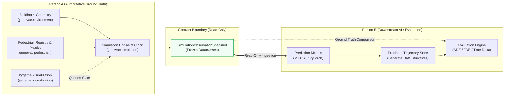

# GenEvac-Sentinel: Person B Handover Specification

**Document Version:** 1.0  
**Phase:** Person A Phase 4 Final Handover  
**Repository Working Directory:** `/Users/apple/Documents/5th sem el/main_el_5/genevac`  
**Git Branch:** `pavan`  
**Python Runtime:** Python 3.11 (tested on 3.11.15)  
**Dependencies:** `pygame==2.6.1`, `pytest==9.2.0`, `setuptools==79.0.1`

---

## 1. System Ownership and Boundaries

GenEvac-Sentinel is partitioned into two clear domains of responsibility:



### 1.1 Person A Responsibilities (Simulation Ground Truth)
- **Environment & Building**: Architectural boundaries, rooms, corridors, physical wall thickness ($0.2\text{ m}$), doorway portals, boundary exits, and static interior obstacles (`genevac.environment`).
- **Pedestrian Domain**: Authoritative pedestrian state, radii ($r = 0.25\text{ m}$), preferred speeds, discrete lifecycle statuses (`ACTIVE`, `EVACUATED`, `BLOCKED`, `INACTIVE`), and the population registry (`genevac.pedestrian`).
- **Simulation Mechanics**: Drift-free simulation clock ($\Delta t = 0.1\text{ s}$), visibility-graph + A* route generation, multi-candidate right-hand collision deflection kinematics, exit crossing threshold detection, dynamic exit closure events, and immutable snapshot generation (`genevac.simulation`).
- **Visualization**: Pygame application loop, coordinate projection viewport, and scene rendering (`genevac.visualization`).

### 1.2 Person B Responsibilities (Prediction & Evaluation)
- **Prediction Subsystem**: AI / MID / deep learning models to forecast pedestrian trajectories and evacuation times.
- **Feature Pipeline**: Ingestion of read-only observation snapshots and extraction of positional, velocity, and history features.
- **Predicted Trajectory Management**: Downstream data structures storing model predictions separately from simulation state.
- **Evaluation & Benchmarking**: Implementation of prediction metrics (e.g. Average Displacement Error [ADE], Final Displacement Error [FDE], arrival error) comparing predictions against subsequent actual snapshots.

### 1.3 Strict Inviolable Rules
1. **Simulation Truth Is Inviolable**: Predictions must **never** overwrite, alter, or steer actual pedestrian coordinates, velocities, statuses, waypoints, history, or clock time.
2. **Read-Only Ingestion**: Person B consumes state exclusively through `SimulationObservationSnapshot` (or public engine getters). Private engine internals (`_`) must never be accessed or modified.
3. **No Simulation Logic Alteration**: Person B must not modify movement physics, collision handling, building geometry, or observation schemas without prior mutual review.

---

## 2. Authoritative Observation Contract (Verified in Source)

All observation models are defined in [`src/genevac/simulation/observation.py`](file:///Users/apple/Documents/5th%20sem%20el/main_el_5/genevac/src/genevac/simulation/observation.py) and [`src/genevac/pedestrian/models.py`](file:///Users/apple/Documents/5th%20sem%20el/main_el_5/genevac/src/genevac/pedestrian/models.py).

### 2.1 Coordinate Frame and Physical Units
- **Origin**: Continuous 2D Euclidean space with $(0.0, 0.0)$ at the **top-left corner**.
- **Axes**: $+X$ extends to the right (East), $+Y$ extends downward (South).
- **Physical SI Units**:
  - Distance / Coordinates: Metres ($\text{m}$).
  - Velocity: Metres per second ($\text{m/s}$).
  - Time / Durations: Seconds ($\text{s}$).
  - Angles / Directions: Standard radians / degrees in continuous space.

### 2.2 Emission Cadence and Intermediate `None`
- **Physics Timestep**: $\Delta t = 0.1\text{ s}$ ($10\text{ Hz}$).
- **Observation Cadence**: $0.4\text{ s}$ ($2.5\text{ Hz}$, exactly every 4 physics steps).
- **Stepping Behavior**:
  - `SimulationEngine.step() -> Optional[SimulationObservationSnapshot]`
  - When `step_count % 4 == 0`, a frozen snapshot is returned.
  - On intermediate substeps (`step_count % 4 != 0`), `step()` returns **`None`**.
  - `SimulationEngine.get_snapshot() -> SimulationObservationSnapshot` generates an on-demand snapshot at any time without advancing the clock.

### 2.3 Data Structures and Exact Fields

#### `SimulationObservationSnapshot` (`@dataclass(frozen=True)`)
| Field Name | Type | SI Units | Description & Guarantees |
| :--- | :--- | :--- | :--- |
| `snapshot_id` | `str` | N/A | Run-local step-derived identifier string: `f"{snapshot_prefix}_{step_count:06d}"` (e.g. `"snap_000004"`). Monotonic within a single run; resets to `"snap_000000"` on reset. Not globally unique across separate runs. |
| `step_count` | `int` | dimensionless | Simulation physics step counter ($\ge 0$). |
| `simulation_step` | `int` | dimensionless | Property alias for `step_count`. |
| `timestamp` | `float` | seconds ($\text{s}$) | Elapsed simulation time ($t = \text{step\_count} \times \Delta t$, rounded to 9 decimal places). |
| `dt` | `float` | seconds ($\text{s}$) | Physics integration step ($0.1\text{ s}$). |
| `observation_interval` | `float` | seconds ($\text{s}$) | Scheduled cadence between observations ($0.4\text{ s}$). |
| `total_count` | `int` | dimensionless | Total registered population ($N$). Strictly equals `len(pedestrians)`. |
| `active_count` | `int` | dimensionless | Number of agents in `active` status. |
| `evacuated_count` | `int` | dimensionless | Number of agents in `evacuated` status. |
| `blocked_count` | `int` | dimensionless | Number of agents in `blocked` status. |
| `inactive_count` | `int` | dimensionless | Number of agents in `inactive` status. |
| `pedestrians` | `tuple[PedestrianObservation, ...]` | N/A | Concrete immutable tuple of agent observations. |

> **Population Consistency Invariant**:
> $$\text{total\_count} = \text{active\_count} + \text{evacuated\_count} + \text{blocked\_count} + \text{inactive\_count} = \text{len}(\text{pedestrians})$$

#### `PedestrianObservation` (`@dataclass(frozen=True)`)
| Field Name | Type | SI Units | Description |
| :--- | :--- | :--- | :--- |
| `pedestrian_id` | `str` | N/A | Stable unique agent string identifier (e.g. `"ped_1"`). |
| `x` | `float` | metres ($\text{m}$) | Current X coordinate in building world space. |
| `y` | `float` | metres ($\text{m}$) | Current Y coordinate in building world space. |
| `vx` | `float` | $\text{m/s}$ | Instantaneous velocity component along X-axis. |
| `vy` | `float` | $\text{m/s}$ | Instantaneous velocity component along Y-axis. |
| `speed` | `float` | $\text{m/s}$ | Scalar speed magnitude: $\sqrt{v_x^2 + v_y^2}$. |
| `status` | `str` | N/A | Lowercase string: `"active"`, `"evacuated"`, `"blocked"`, `"inactive"`. |
| `target_exit_id` | `Optional[str]` | N/A | Target exit identifier string, or `None`. |
| `trajectory_history` | `tuple[TimestampedTrajectoryPoint, ...]` | N/A | Concrete immutable tuple of historical trajectory samples. |

#### `TimestampedTrajectoryPoint` (`@dataclass(frozen=True)`)
| Field Name | Type | SI Units | Description |
| :--- | :--- | :--- | :--- |
| `step` | `int` | dimensionless | Physics step index at time of sample recording. |
| `timestamp` | `float` | seconds ($\text{s}$) | Elapsed simulation time at sample recording. |
| `x` | `float` | metres ($\text{m}$) | Sampled X coordinate. |
| `y` | `float` | metres ($\text{m}$) | Sampled Y coordinate. |

### 2.4 Lifecycle Semantics & Retention
1. **Deep Immutability**: All observation classes are decorated with `@dataclass(frozen=True)` and wrap collections in immutable `tuple` instances. Attempting to modify attributes or collections raises `FrozenInstanceError`.
2. **Permanent Agent Retention**: Evacuated agents are **never dropped** from `pedestrians` in subsequent snapshots. When an agent exits, their `status` becomes `"evacuated"`, velocity becomes $(0.0, 0.0)$, and they remain in every subsequent snapshot to allow complete post-evacuation evaluation.
3. **Trajectory History Rolling Window**:
   - Recorded strictly on observation ticks ($0.4\text{ s}$ intervals) and at step 0 ($t = 0.0\text{ s}$).
   - Bounded by `max_history_len = 100`.
   - 100 samples cover 99 observation steps ($99 \times 0.4\text{ s} = 39.6\text{ s}$, approximately $40.0\text{ s}$ of recent history). If full lifetime history across longer simulations is required, Person B must record snapshots sequentially.
4. **Snapshot ID Generation and Reset Semantics**:
   - `snapshot_id` is generated deterministically from the integer simulation step: `f"{snapshot_prefix}_{step_count:06d}"` (default prefix `"snap"`, e.g. `"snap_000000"`, `"snap_000004"`).
   - It is strictly monotonic and unique **only within a single continuous simulation run**.
   - Upon engine reset or when creating a new `SimulationEngine` instance, `step_count` restarts at `0`, generating identical snapshot IDs (`"snap_000000"`, `"snap_000004"`, etc.).
   - `snapshot_id` is **NOT globally unique** across multiple runs or experiment trials.
5. **Absence of `run_id`**:
   - `SimulationObservationSnapshot` does **not** contain an independent `run_id` or `session_id` field.
   - Downstream experiment runners must explicitly track execution session/trial identifiers externally (e.g. by wrapping snapshots in session containers or saving outputs into run-specific directories).

---

## 3. Initialization and Consumption Blueprint

To ensure proper geometric pre-validation, area inference, and initial route generation, Person B must pass the initial pedestrian population into the `SimulationEngine` constructor rather than registering agents post-construction.

### Minimal Runnable Workflow

```python
"""Person B Ingestion and Prediction Evaluation Blueprint."""

import math
from typing import NamedTuple

from genevac.environment.builder import create_initial_building
from genevac.pedestrian.models import PedestrianState, Point
from genevac.simulation.engine import SimulationEngine
from genevac.simulation.observation import PedestrianObservation, SimulationObservationSnapshot


class PredictedPoint(NamedTuple):
    step: int
    timestamp: float
    x: float
    y: float


def run_person_b_pipeline():
    # 1. Instantiate the authoritative building environment
    building = create_initial_building()

    # 2. Define the initial pedestrian cohort
    initial_cohort = [
        PedestrianState(
            id="agent_1",
            position=Point(8.0, 6.0),
            current_area_id="room_1",
            target_exit_id="exit_left",
            preferred_speed=1.3,
            radius=0.25,
        ),
        PedestrianState(
            id="agent_2",
            position=Point(28.0, 6.0),
            current_area_id="room_2",
            target_exit_id="exit_right",
            preferred_speed=1.2,
            radius=0.25,
        ),
    ]

    # 3. Pass population into SimulationEngine during construction (enables validation & routing)
    engine = SimulationEngine(
        building=building,
        registry=initial_cohort,
        dt=0.1,
        observation_interval=0.4,
    )

    # 4. Storage for Person B's separate predictions: {ped_id: list[PredictedPoint]}
    stored_predictions: dict[str, list[PredictedPoint]] = {}

    # 5. Warm up simulation for 10 steps (1.0 second)
    engine.run_steps(10)
    current_obs = engine.get_snapshot()

    # 6. Generate a 10-step horizon forecast (separate from simulation state)
    horizon_steps = 10
    forecast_dt = 0.1
    for ped in current_obs.pedestrians:
        if ped.status == "active":
            preds = []
            for h in range(1, horizon_steps + 1):
                future_step = current_obs.step_count + h
                future_time = current_obs.timestamp + h * forecast_dt
                # Example: Constant-velocity baseline forecast
                px = ped.x + ped.vx * (h * forecast_dt)
                py = ped.y + ped.vy * (h * forecast_dt)
                preds.append(PredictedPoint(future_step, future_time, px, py))
            stored_predictions[ped.pedestrian_id] = preds

    # 7. Advance authoritative simulation to reach ground truth horizon
    engine.run_steps(horizon_steps)
    future_ground_truth = engine.get_snapshot()

    # 8. Evaluate predictions against actual future observations using matching IDs
    print(f"--- Evaluation at Step {future_ground_truth.step_count} (t={future_ground_truth.timestamp:.2f}s) ---")
    for actual_ped in future_ground_truth.pedestrians:
        if actual_ped.pedestrian_id in stored_predictions:
            final_predicted = stored_predictions[actual_ped.pedestrian_id][-1]
            fde = math.hypot(final_predicted.x - actual_ped.x, final_predicted.y - actual_ped.y)
            print(f"Pedestrian {actual_ped.pedestrian_id}:")
            print(f"  Predicted final pos: ({final_predicted.x:.3f}, {final_predicted.y:.3f})")
            print(f"  Actual ground truth: ({actual_ped.x:.3f}, {actual_ped.y:.3f})")
            print(f"  Status: {actual_ped.status}")
            print(f"  Final Displacement Error (FDE): {fde:.3f} metres")


if __name__ == "__main__":
    run_person_b_pipeline()
```

---

## 4. Evaluation and Benchmarking Boundaries

1. **Evaluation Is Ground-Truth Comparison**:
   - Predictions must be evaluated by comparing predicted coordinate tuples against subsequent actual observations emitted by `SimulationEngine`.
   - Matching must pair exact `pedestrian_id` strings across corresponding future timestamps or step counts.
2. **Pedestrian Status Handling in Evaluation**:
   - **`active`**: Evaluate displacement errors (ADE, FDE) normally.
   - **`evacuated`**: Ground truth coordinates are frozen at the exit portal ($v = 0.0\text{ m/s}$). Models that forecast agents continuing past the exit boundary will accumulate displacement error unless they account for exit thresholds.
   - **`blocked`**: Agent velocity is $0.0\text{ m/s}$ at the blocked location.
   - **`inactive`**: Reserved agents; exclude from active trajectory displacement metrics.
3. **Temporal Leakage Prevention**:
   - In offline dataset generation, ensure training, validation, and test splits strictly separate time intervals or distinct simulation runs. Never allow feature windows to peek into future steps.
4. **Metric Implementation Responsibility**:
   - Standard trajectory metrics (such as Average Displacement Error [ADE], Final Displacement Error [FDE], and evacuation time delta) are evaluation concepts to be implemented by Person B. Person A's engine provides the physical ground truth; it does not compute predictive displacement errors.

---

## 5. Developer Environment and Verification

### 5.1 Environment Prerequisites
- **Python**: `>=3.11` (verified with Python 3.11.15)
- **Virtual Environment**: `.venv`

```bash
# Environment initialization
cd genevac
python3.11 -m venv .venv
source .venv/bin/activate
pip install -r requirements-dev.txt
```

### 5.2 Verified Execution Commands
All commands below have been tested and verified in the repository:

| Task | Verified Working Command |
| :--- | :--- |
| **Run Full Test Suite** | `.venv/bin/pytest` |
| **Run Test Suite (Verbose)** | `.venv/bin/pytest -v` |
| **Headless Smoke Test** | `SDL_VIDEODRIVER=dummy PYTHONPATH=src .venv/bin/python3 -c "from genevac.visualization.app import SimulationApp; app = SimulationApp(width=800, height=600); app.run(max_frames=30); print('Headless OK')"` |
| **Interactive GUI Launch** | `PYTHONPATH=src .venv/bin/python3 -m genevac.visualization.app` |
| **Launch with Custom Step**| `PYTHONPATH=src .venv/bin/python3 -m genevac.visualization.app --dt 0.05 --width 1400 --height 900` |
| **Person B Ingestion Demo** | `PYTHONPATH=src .venv/bin/python3 examples/person_b_integration_demo.py` |

---

## 6. Pre-Handover Checklist for Person B

Before beginning model training or architecture integration, Person B should confirm:

- [ ] Read [`docs/PROJECT_OVERVIEW.md`](file:///Users/apple/Documents/5th%20sem%20el/main_el_5/genevac/docs/PROJECT_OVERVIEW.md) and [`docs/SIMULATION_OBSERVATION_CONTRACT.md`](file:///Users/apple/Documents/5th%20sem%20el/main_el_5/genevac/docs/SIMULATION_OBSERVATION_CONTRACT.md).
- [ ] Ensure that `PYTHONPATH=src` is set when running custom Python scripts directly from the workspace root.
- [ ] Verify that your ingestion loop handles intermediate `None` returns from `engine.step()`.
- [ ] Verify that initial pedestrian cohorts are passed to `SimulationEngine(building=..., registry=cohort)` during construction.
- [ ] Confirm that predictions are stored in separate data structures and never assigned back to `engine.registry` or `ped.position`.
- [ ] Confirm awareness that `SimulationObservationSnapshot` does not feature an independent `run_id` field; handle multi-trial IDs in your wrapper.
- [ ] Verify that your test suite and prediction code runs against `.venv` with `pytest`.

