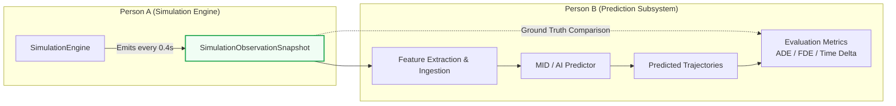

# GenEvac-Sentinel: Person B Integration Guide

## 1. Overview and Engineering Scope

Person B is responsible for the **prediction, machine learning, and evaluation subsystem** of GenEvac-Sentinel. This includes:
- AI / MID model integration for pedestrian trajectory prediction.
- Real-time evacuation time estimation.
- Prediction accuracy evaluation (e.g., Average Displacement Error [ADE], Final Displacement Error [FDE]).

This guide provides the technical blueprint for Person B to consume simulation data cleanly, safely, and deterministically.

---

## 2. Fundamental Architectural Boundaries

The core architectural boundary of GenEvac-Sentinel is:
> **The Simulation Engine is the authoritative ground truth.**
> Predictions must NEVER overwrite, modify, or control physical simulation movement.



### Key Principles for Person B
1. **Read-Only Ingestion**: Ingest snapshots via `SimulationEngine.step()`, `SimulationEngine.latest_snapshot`, or `SimulationEngine.get_snapshot()`. Never modify engine internals.
2. **Deep Immutability**: Snapshots are frozen dataclasses containing immutable tuples. Attempting to assign fields raises `FrozenInstanceError`.
3. **No Simulation Control**: The predictor observes and forecasts; it does not steer agents or alter building obstacles.

---

## 3. How to Ingest Simulation Snapshots

The simulation operates on a **$0.1\text{ s}$ physics timestep** ($\Delta t$) and emits observations every **$0.4\text{ s}$** ($2.5\text{ Hz}$).

### Stepping Loop Pattern

```python
from genevac.environment.builder import create_initial_building
from genevac.pedestrian.models import PedestrianState, Point
from genevac.simulation.engine import SimulationEngine

# 1. Initialize environment and initial population cohort
building = create_initial_building()
initial_cohort = [
    PedestrianState(id="p1", position=Point(8.0, 6.0), current_area_id="room_1", target_exit_id="exit_left")
]

# 2. Pass population cohort to SimulationEngine constructor for pre-validation and routing
engine = SimulationEngine(building=building, registry=initial_cohort, dt=0.1, observation_interval=0.4)

# 3. Step the engine and capture observation ticks
for step_idx in range(40):  # 40 steps = 4.0 seconds of simulation
    snapshot = engine.step()
    
    # Engine returns None on intermediate physics substeps (steps 1, 2, 3, 5, ...)
    if snapshot is not None:
        print(f"Observation tick {snapshot.step_count}: time={snapshot.timestamp:.2f}s, active={snapshot.active_count}")
        for ped in snapshot.pedestrians:
            print(f"  Pedestrian {ped.pedestrian_id}: pos=({ped.x:.2f}, {ped.y:.2f}), vel=({ped.vx:.2f}, {ped.vy:.2f})")
```

---

## 4. Complete Runnable Example: Baseline Predictor & Evaluator

The following self-contained script demonstrates how Person B can consume snapshots, execute a constant-velocity baseline predictor, and evaluate predicted trajectories against actual future ground truth:

```python
"""Example Person B Integration Script: Constant-Velocity Baseline Predictor."""

import math
from typing import NamedTuple
from genevac.environment.builder import create_initial_building
from genevac.pedestrian.models import PedestrianState, Point
from genevac.simulation.engine import SimulationEngine
from genevac.simulation.observation import SimulationObservationSnapshot, PedestrianObservation


class PredictedPoint(NamedTuple):
    step: int
    timestamp: float
    x: float
    y: float


def predict_constant_velocity(
    obs: PedestrianObservation,
    current_step: int,
    current_time: float,
    dt: float,
    horizon_steps: int = 10,
) -> list[PredictedPoint]:
    """Predict future positions assuming linear constant velocity."""
    predictions = []
    for h in range(1, horizon_steps + 1):
        future_step = current_step + h
        future_time = current_time + h * dt
        pred_x = obs.x + obs.vx * (h * dt)
        pred_y = obs.y + obs.vy * (h * dt)
        predictions.append(PredictedPoint(future_step, future_time, pred_x, pred_y))
    return predictions


def run_prediction_experiment():
    building = create_initial_building()
    
    # Define initial pedestrian agent
    agent = PedestrianState(
        id="agent_alpha",
        position=Point(10.0, 15.0),
        target_exit_id="exit_left",
        preferred_speed=1.4,
    )
    
    # Initialize engine with the pedestrian population for validation & routing
    engine = SimulationEngine(building=building, registry=[agent], dt=0.1, observation_interval=0.4)

    # Warm up simulation for 10 steps (1.0 second)
    engine.run_steps(10)
    observation = engine.get_snapshot()
    agent_obs = next(p for p in observation.pedestrians if p.pedestrian_id == "agent_alpha")

    # Generate 10-step forecast (1.0 second into the future)
    horizon = 10
    forecast = predict_constant_velocity(
        obs=agent_obs,
        current_step=observation.step_count,
        current_time=observation.timestamp,
        dt=0.1,
        horizon_steps=horizon,
    )

    # Advance the authoritative simulation to collect ground truth
    engine.run_steps(horizon)
    final_snapshot = engine.get_snapshot()
    final_actual = next(p for p in final_snapshot.pedestrians if p.pedestrian_id == "agent_alpha")

    # Compute Final Displacement Error (FDE)
    pred_final = forecast[-1]
    fde = math.hypot(pred_final.x - final_actual.x, pred_final.y - final_actual.y)

    print("--- Prediction Experiment Complete ---")
    print(f"Agent ID: {agent_obs.pedestrian_id}")
    print(f"Predicted Position at Step {pred_final.step}: ({pred_final.x:.3f}, {pred_final.y:.3f})")
    print(f"Actual Position at Step {final_snapshot.step_count}: ({final_actual.x:.3f}, {final_actual.y:.3f})")
    print(f"Final Displacement Error (FDE): {fde:.3f} metres")


if __name__ == "__main__":
    run_prediction_experiment()
```

> **Execution Note**: When running standalone integration scripts from the repository root, ensure `PYTHONPATH=src` is set:
> ```bash
> PYTHONPATH=src .venv/bin/python3 path/to/script.py
> ```

---

## 5. Person B Integration Checklist

Before deploying prediction models, verify compliance with this checklist:

- [ ] **No Engine Mutations**: Ensure code never sets private attributes (`_`) or alters `engine.registry` directly during stepping.
- [ ] **Handle Intermediate `None`**: Verify that your observation pipeline checks `if snapshot is not None` when calling `engine.step()`.
- [ ] **Explicit Run Identification**: Manage multi-run session identifiers (e.g. `run_001`, `run_002`) in your experiment wrapper, as snapshots do not provide an independent `run_id`.
- [ ] **SI Units Compliance**:
  - Positions: Metres ($\text{m}$)
  - Velocities: Metres per second ($\text{m/s}$)
  - Timestamps: Seconds ($\text{s}$)
  - Angles / Directions: Standard trigonometry (continuous 2D space)
- [ ] **Status Handling**: Ensure models correctly branch logic when an agent is `evacuated` (speed is $0.0$, position fixed) or `blocked` (no route available).
- [ ] **Trajectory Window Awareness**: Be aware that `obs.trajectory_history` contains the most recent $\le 100$ samples ($40\text{ s}$). Maintain your own buffer if full lifetime history across long sessions is required.

