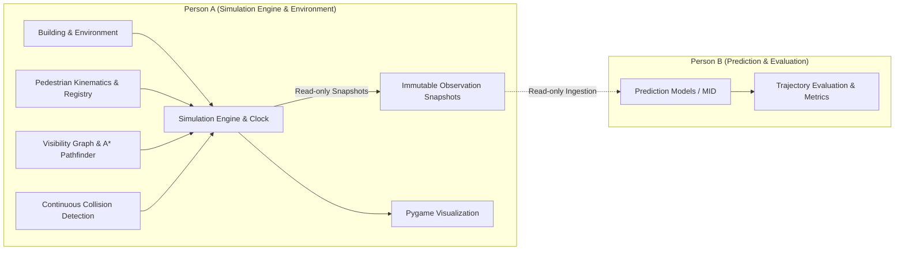
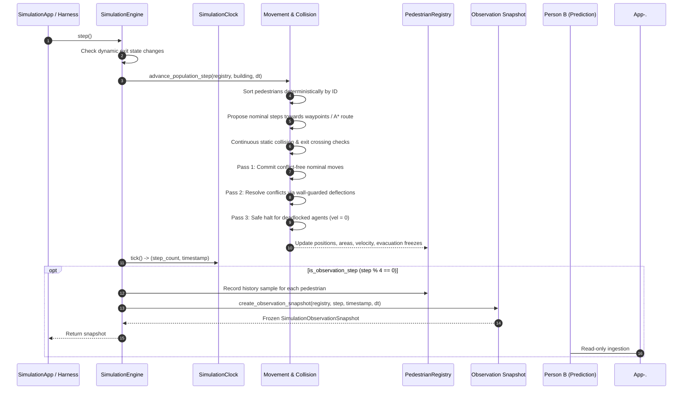

# GenEvac-Sentinel — Project Overview & Architecture

## 1. Project Purpose & Scope

**GenEvac-Sentinel** is an educational evacuation simulation prototype developed in Python. Its goal is to model 2D building environments, pedestrian kinematics, navigation, and exit evacuation under controlled, deterministic conditions, and to provide clean observation interfaces for downstream machine learning and trajectory prediction research.

> [!IMPORTANT]
> **Prototype Scope Notice**: GenEvac-Sentinel is strictly an educational research prototype. It is **not** a certified life-safety system, building code compliance tool, or fire-safety egress simulator.

---

## 2. Ownership & Responsibility Boundaries

The project architecture is strictly partitioned between two distinct engineering scopes:

### Person A Ownership (Authoritative Simulation)
- Building geometry, rooms, corridors, walls, doorways, static obstacles, and boundary exits.
- Authoritative pedestrian models, physical parameters ($r, v_{\text{pref}}$), and population registry.
- Drift-free deterministic simulation clock ($\Delta t = 0.1\text{ s}$) and execution lifecycle.
- Continuous kinematics, visibility graph construction, A* path planning, and wall/obstacle collision checking.
- Multi-pedestrian continuous collision detection and right-hand rule deflection resolution.
- Exit crossing detection, evacuation freezing, dynamic exit closures, and structured simulation events.
- Read-only, deeply immutable observation snapshots emitted at 2.5 Hz cadence.
- 2D Pygame visualization, aspect-ratio preserving viewport, and user interaction loop.

### Person B Ownership (Prediction & Evaluation)
- Predictive trajectory modelling (e.g. Motion Indeterminate Diffusion / MID).
- Ingestion of read-only observation snapshots emitted by Person A's simulation engine.
- Trajectory prediction evaluation, displacement error computation, and benchmark metrics.

### Authoritative State Boundary
- The simulation engine (`SimulationEngine`) is the **sole authoritative source of truth** for all physical positions, velocities, and statuses.
- Predictions produced by Person B must **never overwrite, modify, or feed back into** actual simulation state.
- Simulation modules maintain zero dependencies on `torch`, `mid`, or machine learning frameworks.

---

## 3. High-Level System Architecture

GenEvac-Sentinel consists of four cohesive modules within the `genevac` package:

1. **`genevac.environment`**: Defines geometric primitives (`Point`, `Rectangle`, `LineSegment`, `Wall`), building structures (`WalkableArea`, `Doorway`, `Obstacle`, `Exit`, `Building`), canonical floor plan builder, and JSON serialization.
2. **`genevac.pedestrian`**: Manages pedestrian state (`PedestrianState`), 2D velocities (`Velocity2D`), timestamped trajectory history (`TimestampedTrajectoryPoint`), and population registry (`PedestrianRegistry`).
3. **`genevac.simulation`**: Owns the simulation lifecycle (`SimulationEngine`), deterministic clock (`SimulationClock`), continuous navigation and collision resolution (`movement`), structured immutable events (`SimulationEvent`), and read-only observation contracts (`SimulationObservationSnapshot`, `PedestrianObservation`).
4. **`genevac.visualization`**: Provides viewport coordinate projection (`Viewport`), 2D floor-plan and agent rendering (`EnvironmentRenderer`), and a fixed-timestep interactive application loop (`SimulationApp`).

---

## 4. Simulation Data Flow

The simulation progresses in discrete timesteps ($\Delta t = 0.1\text{ s}$):

---

## 5. Architectural Isolation Guarantees

The simulation core enforces strict dependency boundaries:

| Module | Allowed External Dependencies | Prohibited Dependencies |
| :--- | :--- | :--- |
| `genevac.environment` | Standard library (`dataclasses`, `math`, `json`, `typing`) | `pygame`, `torch`, `numpy`, `mid` |
| `genevac.pedestrian` | Standard library, `genevac.environment` | `pygame`, `torch`, `numpy`, `mid` |
| `genevac.simulation` | Standard library, `genevac.environment`, `genevac.pedestrian` | `pygame`, `torch`, `numpy`, `mid` |
| `genevac.visualization` | Standard library, `pygame`, `genevac.environment`, `genevac.pedestrian`, `genevac.simulation` | `torch`, `mid` |

These guarantees are programmatically enforced by automated architectural isolation tests (`test_no_disallowed_imports` and `test_simulation_architectural_isolation`).

