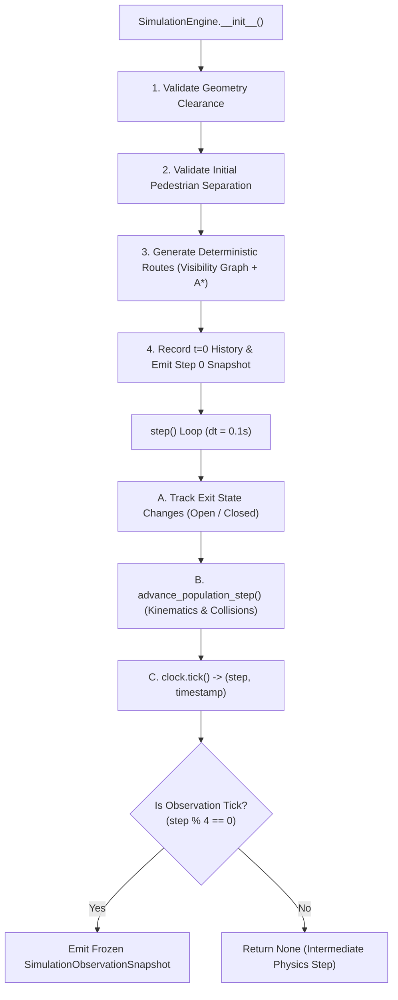

# GenEvac-Sentinel — Simulation Engine & Kinematics Specification

## 1. Engine Architecture & Temporal Model

The `SimulationEngine` (located in [`src/genevac/simulation/engine.py`](file:///Users/apple/Documents/5th%20sem%20el/main_el_5/genevac/src/genevac/simulation/engine.py)) is the authoritative simulation driver for Person A's scope. It coordinates environment models, pedestrian kinematics, exit states, collision avoidance, structured events, and observation snapshot generation.



---

## 2. Clock Advancement & Time Model

The temporal model is governed exclusively by `SimulationClock` ([`src/genevac/simulation/clock.py`](file:///Users/apple/Documents/5th%20sem%20el/main_el_5/genevac/src/genevac/simulation/clock.py)):

| Parameter | Default Value | Contract / Meaning |
| :--- | :--- | :--- |
| **Physics Timestep ($\Delta t$)** | $0.1\text{ s}$ | Discrete time interval between consecutive physics integration steps. |
| **Observation Interval** | $0.4\text{ s}$ | Cadence at which observation snapshots are produced ($2.5\text{ Hz}$). |
| **Observation Stride** | $4\text{ steps}$ | Exact integer ratio: $\frac{\text{observation\_interval}}{\Delta t} = \frac{0.4}{0.1} = 4$. |
| **Current Step (`step_count`)** | $0, 1, 2, \dots$ | Monotonically increasing non-negative integer step index. |
| **Derived Time (`timestamp`)** | $\text{round}(\text{step\_count} \times \Delta t, 9)$ | Elapsed simulation time in seconds. Derived directly from integer step count, **eliminating cumulative floating-point drift**. |

### Simulation Time vs Real Wall-Clock Time
- **Simulation Time** advances deterministically by exactly $\Delta t = 0.1\text{ s}$ per call to `engine.step()`.
- **Wall-Clock Time** in interactive visualization is decoupled: a fixed-timestep accumulator accumulates real delta time (`dt_wall`), clamped to a maximum of $0.25\text{ s}$, executing up to 5 simulation steps per rendered frame.
- While paused (`engine.pause()`), simulation time does not advance, and the accumulator does not accumulate time.

---

## 3. Initialization & Safety Invariants

Before any physics steps occur, `_initialize_simulation()` executes mandatory validation:

1. **Building Bounds Containment**: Center coordinates must lie within $[0, \text{width}] \times [0, \text{height}]$.
2. **Target Exit Existence**: Referenced `target_exit_id` must match a registered `Exit` in the building.
3. **Radius-Aware Walkable Space Clearance**: Evaluates `is_position_in_walkable_space(ped.position, ped.radius, building)`.
   - The agent's disc must clear all exterior walls by at least `ped.radius`.
   - The agent's disc must clear all interior dividing walls by at least `ped.radius`.
   - The agent's disc must clear all obstacle bounding boxes by at least `ped.radius`.
   - If invalid, raises `ValueError` immediately.
4. **Mandatory Pairwise Initial Separation**:
   - Compares every pair $(i, j)$ in the registry via `check_pedestrian_overlap()`.
   - If $d(\text{pos}_i, \text{pos}_j) < r_i + r_j$, initialization immediately aborts with:
     ```
     ValueError: Initial pedestrian overlap detected between '<id_i>' at (...) and '<id_j>' at (...)
     ```
   - Zero bypass options exist.

---

## 4. Route Planning & Obstacle Navigation

Route planning is handled deterministically by `generate_deterministic_route()` in [`src/genevac/simulation/movement.py`](file:///Users/apple/Documents/5th%20sem%20el/main_el_5/genevac/src/genevac/simulation/movement.py) via a two-tiered routing architecture:

### Tier 1: Canonical Topological Routing
1. `_generate_canonical_route(building, start_pos, start_area_id, target_exit, radius)`:
   - Evaluates direct geometric and doorway connectivity between `start_area_id` and `target_exit.connected_area_id`.
   - Uses door midpoints (`get_doorway_midpoint()`), vertical approach points (e.g. $y=12.0\text{ m}$ for rooms 1/2, $y=18.0\text{ m}$ for rooms 3/4), and corridor entry/turn waypoints (e.g. $(x, 15.0)$).
   - Injects localized room obstacle bypasses via `_get_room_obstacle_bypass()`.
2. `_is_route_collision_free(start_pos, waypoints, radius, building, target_exit)`:
   - Validates that every leg of the candidate canonical route clears all static walls and interior obstacles using `check_collision()`.
   - If collision-free, the canonical route is returned immediately, preserving exact baseline trajectories.

### Tier 2: Visibility Graph & A* Search Fallback
If the canonical route is blocked or custom obstacles are encountered, the engine falls back to `_plan_visibility_graph_route()`:
1. **Topological Reachability Check**:
   - `_has_topological_area_path()` runs a Breadth-First Search (BFS) over the building's doorway connectivity graph. If no topological path exists, raises `NoRouteError`.
2. **Node Generation**:
   - **Start & Goal**: Start position (`start_pos`) and candidate exit portal points (exit midpoint + fractional clearance points at $0.25, 0.75, 0.1, 0.9$ of the usable opening).
   - **Exit Standoffs**: Interior approach points at perpendicular standoffs ($0.4, 1.0, 1.5\text{ m}$).
   - **Doorway Portals & Standoffs**: Doorway midpoints, offset clearance points, and perpendicular standoffs ($0.35, 0.75, 1.5\text{ m}$).
   - **Area Centerlines**: Walkable area centroids and doorway-aligned spine projection points.
   - **Minkowski-Inflated Obstacle Nodes**: Obstacle corners and edge midpoints expanded by $(r + \text{margin})$ for $\text{margin} \in \{0.04, 0.15, 0.35, 0.75\}\text{ m}$.
   - **Gap Centerlines**: Centerline points through narrow passages between obstacles and walls, and between pairs of obstacles.
3. **Deterministic A* Search**:
   - Priority queue: `heapq` of `(f_score, g_score, node_index)`.
   - Heuristic $h(\mathbf{p})$: Exact Euclidean distance to the nearest valid goal point: $\min_{\mathbf{g}} \|\mathbf{p} - \mathbf{g}\|_2$.
   - Edge collision validation: `is_edge_valid(u, v)` calls continuous `check_collision()` with an edge result cache (`edge_cache`).
   - Reconstructs waypoints by backtracking parent pointers.
   - If no valid path reaches the goal, raises `NoRouteError`.

---

## 5. Movement Kinematics & Collision Resolution

Population advancement is handled by `advance_population_step()` in [`src/genevac/simulation/movement.py`](file:///Users/apple/Documents/5th%20sem%20el/main_el_5/genevac/src/genevac/simulation/movement.py):

### Step Ordering
Pedestrians are sorted strictly by stable `ped.id` (`sorted(pedestrians, key=lambda p: p.id)`). Iteration order is deterministic and invariant across all platforms.

### Pass 1: Conflict-Free Nominal Proposals
1. For each active pedestrian, calculate nominal target displacement toward the current waypoint:
   $$\Delta \mathbf{x} = \hat{\mathbf{u}} \cdot \min(v_{\text{pref}} \cdot \Delta t, d_{\text{wp}})$$
2. Check unassigned exit crossings (causes immediate transition to `BLOCKED`).
3. Check dynamic pedestrian conflicts via `has_pedestrian_conflict(..., use_nominal_for_uncommitted=True)`:
   - Evaluates continuous minimum distance over $t \in [0, 1]$ using `check_pedestrian_collision()` against other pedestrians' nominal steps and start positions.
4. If **zero conflict exists**, the nominal move commits immediately. If the move crosses the assigned exit threshold, the agent evacuates.

### Pass 2: Wall-Guarded Right-Hand Deflection Sweeps
For pedestrians with conflicts, the engine runs up to **2 resolution sweeps** (allowing queued followers to advance once a leader has moved) testing candidate directions and speed scalings:
1. **17 Candidate Deflection Angles**:
   - Ordered strictly by the right-hand rule (+angle first, then -angle):
     $$0.0^\circ, +15.0^\circ, -15.0^\circ, +30.0^\circ, -30.0^\circ, +45.0^\circ, -45.0^\circ, +60.0^\circ, -60.0^\circ, +75.0^\circ, -75.0^\circ, +90.0^\circ, -90.0^\circ, +105.0^\circ, -105.0^\circ, +120.0^\circ, -120.0^\circ$$
   - Plus perpendicular exit vector if on final approach to an open exit.
2. **Speed Scaling**: Evaluates speed scales in descending order: $1.0$, $0.65$, and $0.35$.
3. **Collision Checks Applied**:
   - Unassigned exit check: must not cross an unassigned exit opening.
   - Static wall/obstacle guard: `check_collision()` must be `False`.
   - Walkable space boundary guard: `is_position_in_walkable_space()` must be `True`.
   - Dynamic pedestrian guard: `has_pedestrian_conflict(..., use_nominal_for_uncommitted=False)` against all committed end positions must be `False`.
4. **Candidate Selection**:
   - The first candidate combination of scale and direction satisfying all guards commits immediately (`break`).

### Pass 3: Deadlock Handling & Safe Halting
If all candidate directions and speed scales are blocked by geometry or pedestrian separation:
- The pedestrian **remains stationary** at its start position with velocity set to `Velocity2D(0.0, 0.0)`.
- If trapped in a narrow passage by a `BLOCKED` pedestrian or an opposed oncoming pedestrian, it safely transitions to `PedestrianStatus.BLOCKED`. Otherwise, it remains `ACTIVE` with zero velocity for this step.

---

## 6. Exit Evacuation Dynamics

1. **Crossing Detection**: `detect_exit_crossing()` detects intersection of the agent's movement line with the exit segment:
   $$\text{cross\_pt} = \text{SegmentIntersection}(\mathbf{x}_{\text{curr}} \to \mathbf{x}_{\text{cand}}, \text{exit.segment})$$
   The intersection must lie within the lateral exit opening ($y \in [y_{\text{start}} + r, y_{\text{end}} - r]$).
2. **Evacuation Freeze**:
   - `ped.position` is set to `cross_pt`.
   - `ped.status = PedestrianStatus.EVACUATED`.
   - `ped.velocity = Velocity2D(0.0, 0.0)`.
   - `ped.waypoints.clear()`.
3. **Loophole Prevention**: Pedestrians evacuating during step $k$ remain in the dynamic collision set for the remainder of step $k$, preventing trailing agents from clipping through them before the step completes.

