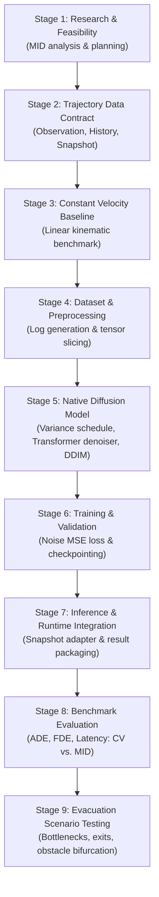

# GenEvac-Sentinel AI Trajectory Prediction Implementation Roadmap

## 1. Overview & Phasing Principles

This roadmap defines the engineering progression from initial feasibility to a fully verified, native **Motion Indeterminacy Diffusion (MID)** trajectory prediction system for **GenEvac-Sentinel**.

The progression is governed by three strict rules:
1. **Simulation State Isolation**: No AI model or prediction component may mutate `SimulationEngine`, `Pedestrian` states, or environment geometry.
2. **Measurable Baselines First**: A rigorous, pure kinematic Constant Velocity (CV) baseline must be fully tested and benchmarked before evaluating learned diffusion models.
3. **Decoupled Architecture**: All models consume read-only `TrajectorySnapshot` inputs and produce `TrajectoryPrediction` outputs through the Part 2 data contract.

---

## 2. Staged Implementation Plan (Stages 1–9)

---

### Stage 1: Research, Feasibility & Boundary Verification
- **Status**: **SUBSTANTIALLY COMPLETE — Corrections applied 2026-10-30** (see `docs/ai/part1_part2_audit_correction_report.md`).
- **Objective**: Audit original Gutianpei/MID implementation, analyze mathematical formulation, establish environment constraints (CPU/Windows), and verify ownership boundaries with Person A.
- **Files**: `docs/mid_feasibility.md`, `docs/ai/part1/mid_methodology_analysis.md`, `docs/ai/part1/genevac_mid_adaptation_design.md`.

---

### Stage 2: Trajectory Data Model and Validation
- **Status**: **COMPLETE — Corrections applied 2026-10-30** (see `docs/ai/part1_part2_audit_correction_report.md`)
- **Note**: Timestamp-gap validation, snapshot deep-immutability tests, and PREDICTED category rejection tests added. See Phase C corrections.
- **Objective**: Establish immutable trajectory data structures, top-left coordinate frame, rolling-window cache, read-only snapshot retrieval, and validation rules.
- **Files**:
  - `src/genevac/prediction/data_contract.py`
  - `src/genevac/prediction/__init__.py`
  - `data/sample/sample_trajectories.json`
  - `tests/test_data_contract.py` (36 passing tests)
- **Completion Criteria**: 100% test pass rate, zero simulation state mutation, immutable snapshots.

---

### Stage 3: Constant Velocity (CV) Baseline Predictor
- **Status**: **COMPLETE — Implemented and verified 2026-10-30** (see `docs/ai/part1_part2_audit_correction_report.md`).
- **Objective**: Implement a pure kinematic constant velocity predictor conforming to the Part 2 contract, providing a fast, deterministic baseline for future comparisons.
- **Source Files**:
  - `src/genevac/prediction/baseline.py` (`ConstantVelocityPredictor`)
  - `tests/test_baseline.py` (20 passing tests)
- **Dependencies**: `TrajectorySnapshot`, `TrajectoryPrediction`, `data_contract.py`.
- **What Must NOT Be Modified**: Person A's `SimulationEngine`, `Pedestrian`, or `EnvironmentMap`. Do not add exit attraction or wall repulsion to this baseline (avoid planner creep).
- **Completion Criteria**: Produces valid `TrajectoryPrediction` from `TrajectorySnapshot` with latency $< 0.2\text{ ms}$ for 100 agents; passes all contract validation checks (all 20 baseline tests pass).
- **Risks**: Pedestrians with short history (< 2 observations); mitigated by raising TrajectoryValidationError with a descriptive message rather than fabricating velocity.

---

### Stage 4: Independent Training Data Pipeline & Preprocessing
- **Target Phase**: Part 4.
- **Objective**: Construct training dataset utilities that slice GenEvac simulation runs into $(X_{obs}, Y_{future})$ pairs without data leakage.
- **Expected Source Files**:
  - `src/genevac/prediction/mid/preprocessing.py`
  - `src/genevac/prediction/mid/dataset.py`
  - `tests/test_mid_dataset.py`
- **Dependencies**: Simulation trajectory logs (JSON/CSV), PyTorch `Dataset` & `DataLoader`.
- **What Must NOT Be Modified**: `data_contract.py`.
- **Completion Criteria**:
  - Partitions training, validation, and test splits at the scenario/seed level.
  - Zero overlapping window leakage across splits.
  - Generates agent-centric normalized displacement tensors $(B, T_{obs}, 4)$ and future targets $(B, T_{pred}, 2)$.
- **Risks**: Variable agent entry and exit times; mitigated by validity masks and padding.

---

### Stage 5: Core Native Diffusion Architecture
- **Target Phase**: Part 5.
- **Objective**: Implement native PyTorch diffusion modeling modules for GenEvac.
- **Expected Source Files**:
  - `src/genevac/prediction/mid/diffusion.py` (`VarianceSchedule`, `DiffusionModel`)
  - `src/genevac/prediction/mid/encoders.py` (`TrajectoryEncoder`, `SocialAttention`)
  - `src/genevac/prediction/mid/denoiser.py` (`TransformerDenoiser`, `ConcatSquashLinear`)
  - `src/genevac/prediction/mid/sampler.py` (`DDIMSampler`, `DDPMSampler`)
  - `tests/test_mid_architecture.py`
- **Dependencies**: Native PyTorch 2.4+ (CPU compatible), `numpy`.
- **What Must NOT Be Modified**: Legacy `research/MID/` code (kept isolated).
- **Completion Criteria**:
  - Forward diffusion adds noise according to closed-form $q(y_t | y_0)$.
  - Denoiser correctly computes MSE loss on arbitrary batch tensors.
  - DDIM sampler generates $K$ candidate trajectories in 2 to 5 steps on CPU.
- **Risks**: Tensor dimension mismatch across conditioning layers; mitigated by unit shape tests.

---

### Stage 6: Model Training & Validation Pipeline
- **Target Phase**: Part 6.
- **Objective**: Build an isolated training loop to train the native GenEvac MID model on simulated evacuation scenarios.
- **Expected Source Files**:
  - `scripts/train_mid.py`
  - `src/genevac/prediction/mid/checkpoint.py`
- **Dependencies**: Stages 4 and 5.
- **Completion Criteria**:
  - Training loss steadily converges on synthetic evacuation scenarios.
  - Validation checkpoints saved with full metadata and random seeds.
  - Supports CPU training and automatic device detection.
- **Risks**: Overfitting on narrow corridor layouts; mitigated by scenario diversity (corners, multi-exit rooms, bottlenecks).

---

### Stage 7: Inference & Runtime Snapshot Integration
- **Target Phase**: Part 7.
- **Objective**: Wrap trained diffusion checkpoints into `GenEvacMIDPredictor`, implementing a clean interface that consumes `TrajectorySnapshot` and emits `TrajectoryPrediction`.
- **Expected Source Files**:
  - `src/genevac/prediction/mid/predictor.py` (`GenEvacMIDPredictor`)
  - `tests/test_mid_predictor.py`
- **Dependencies**: Stages 2, 5, 6.
- **Completion Criteria**:
  - Seamlessly accepts `TrajectorySnapshot` from `TrajectoryHistoryBuffer`.
  - Reconstructs global top-left coordinates in metres.
  - Populates `source_step_index` and future timestamps strictly $> t_{source}$.
  - Zero state mutation or clock advancement in the simulator.

---

### Stage 8: Comparative Benchmark Evaluation (CV vs. MID)
- **Target Phase**: Part 8.
- **Objective**: Execute a rigorous head-to-head evaluation comparing the Constant Velocity baseline against the native MID diffusion model.
- **Expected Source Files**:
  - `scripts/evaluate_models.py`
  - `docs/ai/evaluation_results.md`
- **Metrics Evaluated**:
  - Average Displacement Error (ADE) in metres.
  - Final Displacement Error (FDE) in metres.
  - Best-of-$K$ ADE/FDE ($K=20$) for stochastic multi-modality.
  - 95th-Percentile Inference Latency per agent on host CPU.
  - Mean-of-K ADE/FDE (assessing average sample quality)
  - Collision rate (fraction of predicted positions that overlap with obstacle geometry)
  - Off-walkable prediction rate (where environment geometry is accessible read-only)
  - Metrics broken down by prediction horizon step
  - Metrics broken down by local crowd density
  - p50 and p95 inference latency (measured on host machine, not estimated)
- **Completion Criteria**: Quantitative results reported in distinct, un-fabricated tables comparing linear extrapolation against diffusion forecasting.

---

### Stage 9: Evacuation Scenario Testing & Path Bifurcation Analysis
- **Target Phase**: Part 9.
- **Objective**: Evaluate trajectory predictions under challenging emergency dynamics (narrowing bottlenecks, bifurcated dual exits, pillar obstacles).
- **Expected Deliverables**:
  - Verification that MID generates multi-modal paths around obstacles where CV predicts wall collisions.
  - Analysis of prediction reliability in crowded choke points ($> 2\text{ ped/m}^2$).

