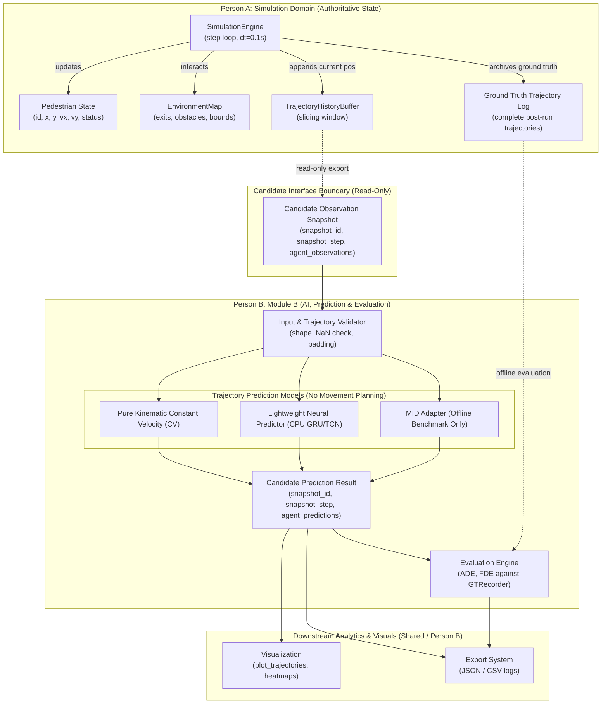

# Module B & Person A Integration Readiness Plan

> [!IMPORTANT]
> **Interface Governance Note**: All dataclasses, function signatures, and data contracts proposed in this document (`TrajectoryObservationBatch`, `TrajectoryPredictionResult`, etc.) are **candidate design proposals subject to formal review and approval by Person A**. Person B will strictly adapt to the agreed simulator interface and will **not** independently alter Person A's classes or impose unapproved requirements.

---

## 1. End-to-End Integration Architecture

The following diagram illustrates the decoupled boundary between Person A's authoritative simulation domain and Person B's prediction and evaluation components:



---

## 2. Five Critical Integration Principles & Resolutions

### 2.1 History Length and Sampling Convention
There is a fundamental difference between sample count $N$ and elapsed observation time $\Delta T_{elapsed}$:
- At simulation timestep $\Delta t = 0.1\text{ s}$, a buffer of $N = 20$ consecutive positions spans:
  $$\Delta T_{elapsed} = (N - 1) \times \Delta t = (20 - 1) \times 0.1\text{ s} = 1.9\text{ seconds}$$
- If Person A's requirement is a full $2.0\text{ seconds}$ observation window, then $N = 21$ samples are required ($(21 - 1) \times 0.1\text{ s} = 2.0\text{ s}$).
- **Action for Person A**: Confirm whether the requirement is strictly $N = 20$ discrete samples ($\Delta T = 1.9\text{ s}$) or a full $2.0\text{ s}$ window ($N = 21$). Person B will parameterize the validator to adapt to Person A's formal specification.

### 2.2 Shared Interface Governance
- The candidate contracts `TrajectoryObservationBatch` and `TrajectoryPredictionResult` are **proposals**, not locked interfaces.
- Person B will write adapter code to consume Person A's native state rather than requesting modifications to `SimulationEngine` or `Pedestrian` unless Person A agrees that exposing step indices in `TrajectoryHistoryBuffer` is mutually beneficial.
- All exchanged data structures will be frozen (`frozen=True`) to guarantee zero state mutation across the boundary.

### 2.3 Strict Separation: Prediction vs. Movement Planning
- **True Baseline Definition**: The primary baseline must remain a **pure kinematic Constant Velocity (CV) / Linear Extrapolation model** relying solely on trajectory history:
  $$p_{t+h} = p_t + h \cdot v_t$$
- **Avoiding Planner Creep**: Integrating goal attraction (exit targets) and obstacle repulsion into a baseline model effectively turns the predictor into an internal motion planner. Goal-conditioned or interaction-aware forecasting must be developed as a separate, distinct model tier only after the inputs (e.g. exit visibility, wall proximity) and evaluation protocols are explicitly defined and approved.

### 2.4 Empirical Latency Benchmarks (No Guessed Numbers)
Theoretical estimates of $< 0.1\text{ ms}$ or $2 - 5\text{ ms}$ have been replaced with **empirical measurements on this target machine** (Intel CPU, PyTorch 2.4.1+cpu, Windows 10/11 AMD64, 200 repetitions):

| Component / Model | Batch: 10 Agents | Batch: 50 Agents | Batch: 100 Agents | Batch: 250 Agents |
|---|---|---|---|---|
| **Pure Kinematic CV Predictor** | 0.025 ms (2.5 µs/agent) | 0.143 ms (2.9 µs/agent) | 0.265 ms (2.7 µs/agent) | 0.664 ms (2.7 µs/agent) |
| **Lightweight PyTorch GRU (CPU)** | 2.555 ms (255 µs/agent) | 9.836 ms (197 µs/agent) | 9.579 ms (95.8 µs/agent) | 15.606 ms (62.4 µs/agent) |
| **Tensor Conversion Overhead** | 0.169 ms | 0.270 ms | 0.484 ms | 1.192 ms |
| **Total Lightweight Neural Pipeline** | **2.72 ms** | **10.11 ms** | **10.06 ms** | **16.80 ms** |

*Key Takeaway*: On CPU, a batch of 50 agents takes $\approx 10.1\text{ ms}$ for neural inference and data conversion. Person A must confirm the simulation's actual real-time latency budget (whether 10 ms, 50 ms, or offline post-processing) before integrating neural models into the active loop.

### 2.5 Lifecycle, Snapshot Tracking, and Ground-Truth Preservation
1. **Anti-Staleness via Snapshot IDs**: Every prediction result must contain:
   - `snapshot_id`: Unique identifier (e.g. UUID or hash).
   - `snapshot_step`: Simulation step at which observations were frozen.
   - `snapshot_timestamp`: Physical simulation time in seconds.
   Downstream components must reject predictions where `current_step > snapshot_step + threshold`.
2. **Lifecycle Handling**:
   - *Newly Spawned Agents* ($< N$ observations): Padded via constant-velocity back-extrapolation or flagged with `INSUFFICIENT_HISTORY`.
   - *Evacuating / Disappearing Agents*: If an agent evacuates during the forecast horizon, their prediction is marked with `EVACUATED_EARLY`, and evaluation against ground truth is truncated at their evacuation step.
3. **Independent Ground-Truth Archive**: Ground-truth trajectory logging must occur in a dedicated structure (`GTRecorder`) independent of active agent lifecycle so that post-run ADE/FDE metrics can be evaluated completely without active-state data loss.

---

## 3. Producer / Consumer Interface Matrix

| Connection | Producer | Consumer | Data Exchanged | Units & Conventions | Error & Missing-Data Behavior | Person A Approval Required? | Testable Independently? |
|---|---|---|---|---|---|---|---|
| **1. State $\to$ History** | `SimulationEngine` | `TrajectoryHistoryBuffer` | Pedestrian ID, position `(x, y)` | Meters, continuous Cartesian | Ignore inactive / evacuated agents | **Yes** (internal to Person A) | Yes |
| **2. History $\to$ Snapshot** | `TrajectoryHistoryBuffer` | Person B `TrajectoryValidator` | Sequence of historical `(x, y)` points per agent + step | Meters, list of tuples, length $N$ | Return empty / insufficient history flag | **Yes** (contract agreement) | Yes |
| **3. Snapshot $\to$ Predictor** | Person B `TrajectoryValidator` | `ITrajectoryPredictor` | Cleaned tensor or validated array | Meters (or normalized $\Delta x, \Delta y$), float32 | Raise `ValidationError` or use fallback padding | No (internal to Person B) | Yes |
| **4. Predictor $\to$ Output** | `ITrajectoryPredictor` | `TrajectoryPredictionResult` | Future coordinates $(\hat{x}, \hat{y})$ for horizon $H$ | Meters, step offsets, snapshot ID | Flag failed prediction status | No (internal to Person B) | Yes |
| **5. Simulation $\to$ Evaluator** | `SimulationEngine` / `GTRecorder` | Person B `PredictionEvaluator` | Ground-truth future trajectory slices | Meters, aligned step timestamps | Prune agents who evacuated early | **Yes** (log access) | Yes |
| **6. Output $\to$ Analytics/Vis** | `TrajectoryPredictionResult` | `visualization` / `export` | Predicted paths vs. ground truth | Meters, standardized Dict/JSON | Render dashed line; log metadata | No | Yes |

---

## 4. Candidate Data Contract Specification (Subject to Approval)

```python
from dataclasses import dataclass
from typing import Tuple, Dict, Optional


@dataclass(frozen=True)
class AgentObservation:
    """Individual pedestrian observation snapshot."""
    agent_id: str
    positions: Tuple[Tuple[float, float], ...]  # Length N (oldest to newest) in meters
    current_step: int                           # Authoritative simulation step index
    status: str                                 # "active", "evacuated", etc.
    timestep: float = 0.1                       # Nominal seconds per step


@dataclass(frozen=True)
class TrajectoryObservationBatch:
    """Read-only batch of observations delivered to Person B."""
    snapshot_id: str                            # Unique snapshot identifier
    snapshot_step: int                          # Simulation step index
    snapshot_time: float                        # Physical time (seconds)
    observations: Dict[str, AgentObservation]
    timestep: float = 0.1


@dataclass(frozen=True)
class AgentPrediction:
    """Prediction for a single agent."""
    agent_id: str
    predicted_positions: Tuple[Tuple[float, float], ...]  # Horizon H points in meters
    step_indices: Tuple[int, ...]                         # Future step numbers
    model_id: str
    status: str = "SUCCESS"                               # "SUCCESS" | "INSUFFICIENT_HISTORY" | "FAILED"
    confidence_scores: Optional[Tuple[float, ...]] = None


@dataclass(frozen=True)
class TrajectoryPredictionResult:
    """Complete prediction output returned by Person B."""
    snapshot_id: str                            # Strictly matches input snapshot_id
    snapshot_step: int                          # Strictly matches input snapshot_step
    predictions: Dict[str, AgentPrediction]
    execution_time_ms: float
```

---

## 5. Contract-Test Plan (To be implemented in Part 2)

| Test ID | Test Name | Purpose / Assertion | Type |
|---|---|---|---|
| `CT-01` | `test_agent_id_preservation` | Output prediction keys strictly match input agent IDs. | Standalone Unit Test |
| `CT-02` | `test_snapshot_id_binding` | Result `snapshot_id` strictly equals observation `snapshot_id`. | Standalone Unit Test |
| `CT-03` | `test_history_ordering` | Verifies that observations are ordered chronologically ($t_{oldest} \to t_{newest}$). | Standalone Unit Test |
| `CT-04` | `test_coordinate_unit_consistency` | Asserts output coordinates remain within expected spatial bounds (meters). | Standalone Unit Test |
| `CT-05` | `test_prediction_horizon_length` | Output sequence length strictly equals requested `horizon_steps`. | Standalone Unit Test |
| `CT-06` | `test_empty_batch_handling` | Passing an empty batch returns an empty result without exceptions. | Standalone Unit Test |
| `CT-07` | `test_insufficient_history_fallback` | Agents with $< N$ observations receive handled fallback without crashing. | Standalone Unit Test |
| `CT-08` | `test_nan_inf_input_rejection` | Feeding `float('nan')` raises a handled `ValidationError`. | Standalone Unit Test |
| `CT-09` | `test_state_immutability` | Verifies `ped.position` is unchanged before and after model inference. | Integration Fixture |
| `CT-10` | `test_clock_immutability` | Verifies `engine.current_step` is identical before and after inference. | Integration Fixture |
| `CT-11` | `test_reproducibility_with_fixed_seed` | Inference outputs are strictly identical when seeded identically. | Standalone Unit Test |

---

## 6. Integration Questions for Person A

Before Person B implements Part 2, Person A must review and decide:

1. **History Length vs. Duration Convention**:
   - Does Person A define the observation window as strictly **$N = 20$ discrete samples** ($\Delta T_{elapsed} = 1.9\text{ s}$ at $dt=0.1\text{ s}$) or as a **$2.0\text{ s}$ elapsed duration** ($N = 21$ samples)?
2. **Review of Candidate Data Contracts**:
   - Are the proposed candidate fields and types in `TrajectoryObservationBatch` and `TrajectoryPredictionResult` acceptable, or does Person A have preferred naming/typing conventions?
3. **Step Indices in History Buffer**:
   - Can `TrajectoryHistoryBuffer.record()` store `(step, x, y)` tuples directly, or should Person B's adapter fetch `engine.current_step` at observation capture time?
4. **Simulation Runtime Budget**:
   - What is Person A's target frame budget for the simulation loop? (e.g. Is an empirical $\approx 10\text{ ms}$ neural prediction latency acceptable for 50 agents in an online loop, or should neural predictions be computed at lower frequencies or strictly offline)?
5. **Ground Truth Logging**:
   - Will Person A provide an authoritative ground-truth trajectory logger in `SimulationEngine` for post-run evaluation, or should Person B attach a read-only post-step hook?
