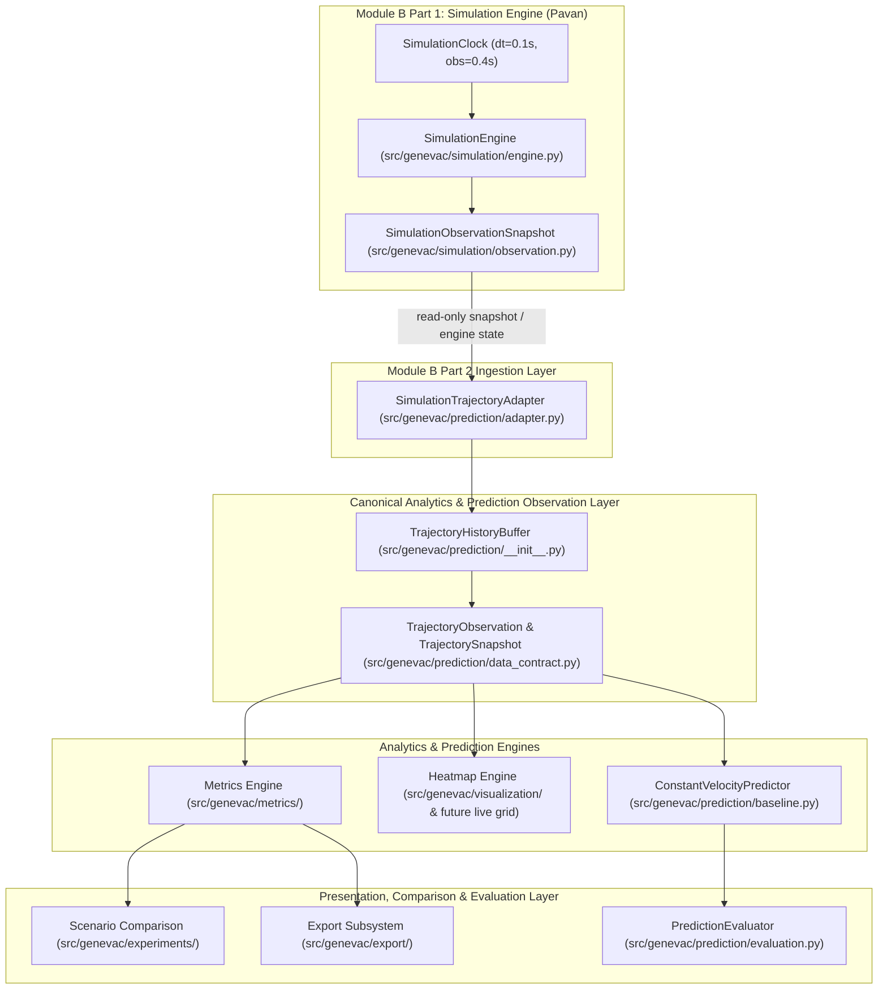

# GenEvac-Sentinel: Person B System Architecture

**Document:** `docs/person_b_architecture.md`  
**Status:** Source-Verified Audit (Phase 1)  
**Author:** Harsha (Person B / Module B Part 2)  
**Upstream Integration:** Pavan (Module B Part 1)  

---

## 1. Intended Logical Architecture vs. Current Repository State

### Component Status Classification

| Component | Status | Source Location | Description |
|---|---|---|---|
| **Simulation Trajectory Adapter** | **EXISTS / VERIFIED** | `src/genevac/prediction/adapter.py` | Bridges engine state/snapshots to Person B buffers, enforces 0.4s cadence, detects resets, isolates cohorts. |
| **Canonical Observation Contract** | **EXISTS / VERIFIED** | `src/genevac/prediction/data_contract.py` | Frozen immutable dataclasses (`TrajectoryObservation`, `TrajectorySnapshot`, `TrajectoryPrediction`). |
| **Trajectory History Buffer** | **EXISTS / VERIFIED** | `src/genevac/prediction/__init__.py` | Per-agent FIFO sliding window with monotonic timestamp and step enforcement. |
| **Baseline Trajectory Predictor** | **EXISTS / VERIFIED** | `src/genevac/prediction/baseline.py` | Constant-velocity extrapolation using actual time deltas `(t2 - t1)`, non-invasive, timestamp-aware. |
| **Prediction Evaluator & Benchmarks** | **EXISTS / VERIFIED** | `src/genevac/prediction/evaluation.py`, `dataset_adapter.py` | Rigorous ADE/FDE metrics, ETH/UCY loaders, zero future leakage validation. |
| **Metrics Engine** | **PARTIAL** | `src/genevac/metrics/__init__.py` | Has `calculate_ade`, `calculate_fde`, `calculate_clearance_time`. Broader evacuation metrics (flow rate, congestion, individual delay) pending Phase 2 catalog. |
| **Heatmap Engine** | **PARTIAL** | `src/genevac/visualization/__init__.py` | Has basic `plot_heatmap` matplotlib renderer. Dedicated numerical spatial grid engine (bounds, cell size, binning, normalization) pending Phase 4. |
| **Scenario Comparison Engine** | **PARTIAL** | `src/genevac/experiments/__init__.py` | Has basic `ExperimentRunner`. Standardized configuration comparison and multi-run aggregation pending Phase 6. |
| **Export Subsystem** | **EXISTS / VERIFIED** | `src/genevac/export/__init__.py` & `evaluation.py` | Has JSON/CSV serialization. Run/scenario metadata schema standardization planned in Phase 8. |
| **MID Investigation & Inference** | **UNRESOLVED / BLOCKED** | `docs/mid_feasibility.md` | Authoritative meaning confirmed as *Motion Indeterminacy Diffusion*. Quarantined in `research/MID/`. Blocked from production execution pending weights and clean standalone architecture. |

---

## 2. Integration Boundary & Read-Only Ingestion

1. **Ownership Boundary**:
   - Pavan owns the simulation dynamics, geometry collisions, exit logic, and clock progression.
   - Harsha consumes engine output strictly as a read-only observer.
2. **Snapshot vs. State Polling**:
   - In Pavan's full reference (`pavan-part1-reference/src/genevac/simulation/engine.py`), the engine generates an immutable `SimulationObservationSnapshot` at every observation stride (0.4 s).
   - In the local working engine (`src/genevac/simulation/__init__.py`), the adapter reads `engine.current_step`, `engine.timestep`, and iterates `engine.pedestrians`.
   - `SimulationTrajectoryAdapter` works compatibly with both by checking public attributes non-invasively and constructing immutable `TrajectoryObservation` records.
3. **Run Isolation & Zero Mutation**:
   - The adapter resets its buffer on step rollback or engine replacement, preventing cross-run contamination.
   - The adapter never modifies pedestrian positions, velocities, status, or engine step counters.

