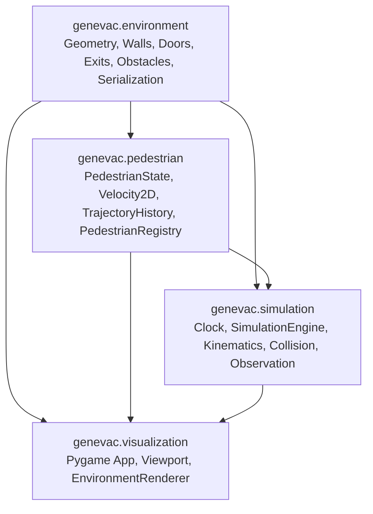

# GenEvac-Sentinel Source Directory (`src/`)

This directory houses the core Python source packages for the GenEvac-Sentinel simulation platform.

## Package Architecture (`src/genevac/`)

The simulation is architected into four decoupled modules:



### 1. `genevac.environment`
- **Purpose**: Defines continuous 2D geometry and architectural building primitives.
- **Key Modules**:
  - `geometry.py`: Primitives (`Point`, `Rectangle`, `LineSegment`, `Wall`).
  - `models.py`: Structural elements (`WalkableArea`, `Doorway`, `Exit`, `Obstacle`, `Building`).
  - `builder.py`: Validated canonical building constructor (`create_initial_building()`).
  - `serialization.py`: Standard library JSON serialization adhering to schema `"1.0"`.

### 2. `genevac.pedestrian`
- **Purpose**: Authoritative model for discrete pedestrian agents and population management.
- **Key Modules**:
  - `models.py`: `PedestrianState`, `Velocity2D`, `TimestampedTrajectoryPoint`, and `PedestrianStatus`.
  - `registry.py`: `PedestrianRegistry` ensuring unique stable IDs, deterministic iteration, dynamic count synchronisation, and indefinite retention of evacuated agents.

### 3. `genevac.simulation`
- **Purpose**: Authoritative simulation driver, pathfinding, continuous collision resolution, and observation generation.
- **Key Modules**:
  - `clock.py`: `SimulationClock` providing integer step advancement with zero floating-point drift.
  - `engine.py`: `SimulationEngine` coordinating lifecycle, routing, stepping, and snapshot emission.
  - `movement.py`: Two-tiered route planning (canonical + visibility graph A*), 17-angle candidate deflection kinematics, and exit portal crossing detection.
  - `observation.py`: `SimulationObservationSnapshot` and `PedestrianObservation` (frozen dataclasses emitted at $2.5\text{ Hz}$).
  - `events.py`: Structured immutable simulation lifecycle event logging.
  - `exceptions.py`: Domain-specific exceptions (`NoRouteError`).

### 4. `genevac.visualization`
- **Purpose**: 2D top-down graphical rendering and interactive execution loop using Pygame.
- **Key Modules**:
  - `app.py`: `SimulationApp` managing window, input event loop, decoupled fixed-timestep accumulator, pause/resume, and reset.
  - `coordinates.py`: `Viewport` maintaining aspect-ratio preservation and uniform margin centering.
  - `renderer.py`: `EnvironmentRenderer` providing read-only architectural rendering and HUD overlays.

## Development Note
When executing standalone scripts or testing modules directly, ensure `PYTHONPATH=src` is set:
```bash
PYTHONPATH=src .venv/bin/python3 -m genevac.visualization.app
```

